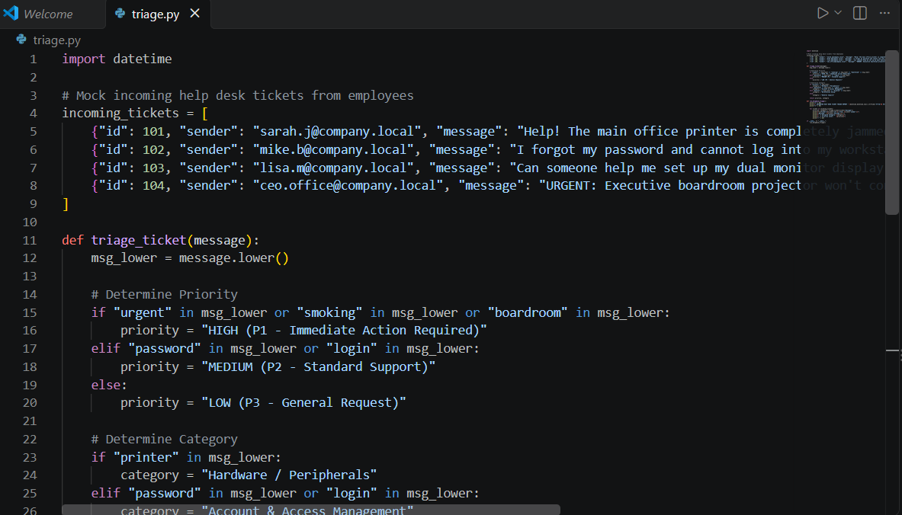
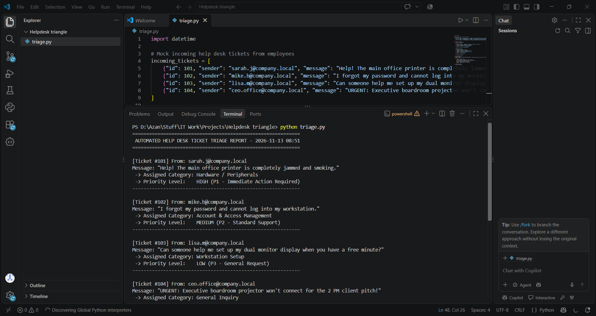

# Automated Help Desk Ticket Triage

## Project Overview
A lightweight Python automation script designed to parse incoming IT support tickets, analyze keyword urgency, categorize technical issues, and generate a structured triage report to streamline help desk workflows.

## Features
* **Automated Priority Routing:** Scans incoming support messages for critical keywords (`urgent`, `smoking`, `boardroom`) and assigns P1–P3 priority levels.
* **Smart Categorization:** Automatically sorts issues into IT buckets like *Hardware / Peripherals*, *Account & Access Management*, and *Workstation Setup*.
* **Structured Reporting:** Outputs a clean, time-stamped terminal report for IT administrators.

---

## Project Visuals

### 1. VS Code Implementation (`triage.py`)


### 2. Terminal Execution & Output


---

## How to Run
1. Ensure you have Python installed on your machine.
2. Download or clone the `triage.py` script.
3. Open your terminal in the script directory and run:
   ```bash
   python triage.py
